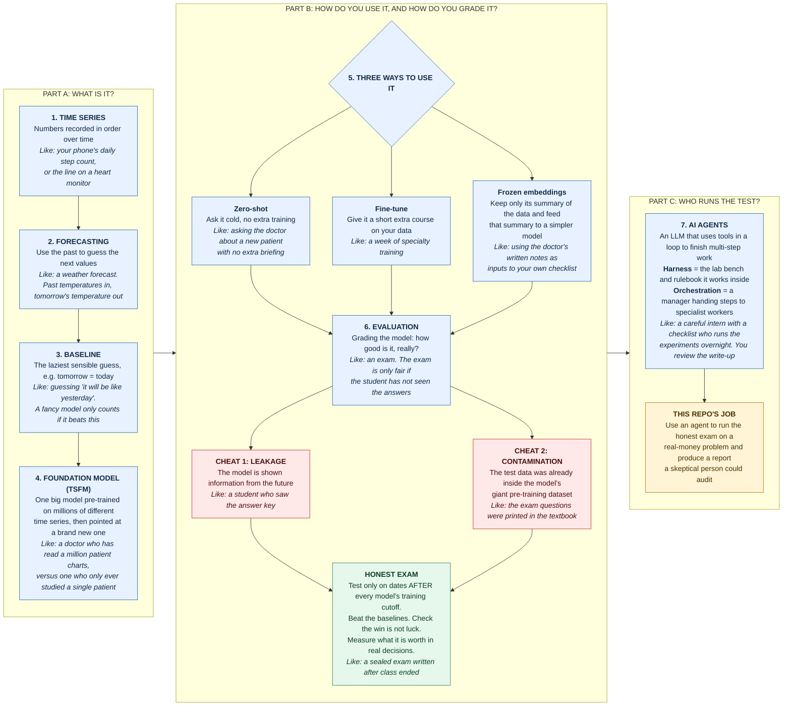
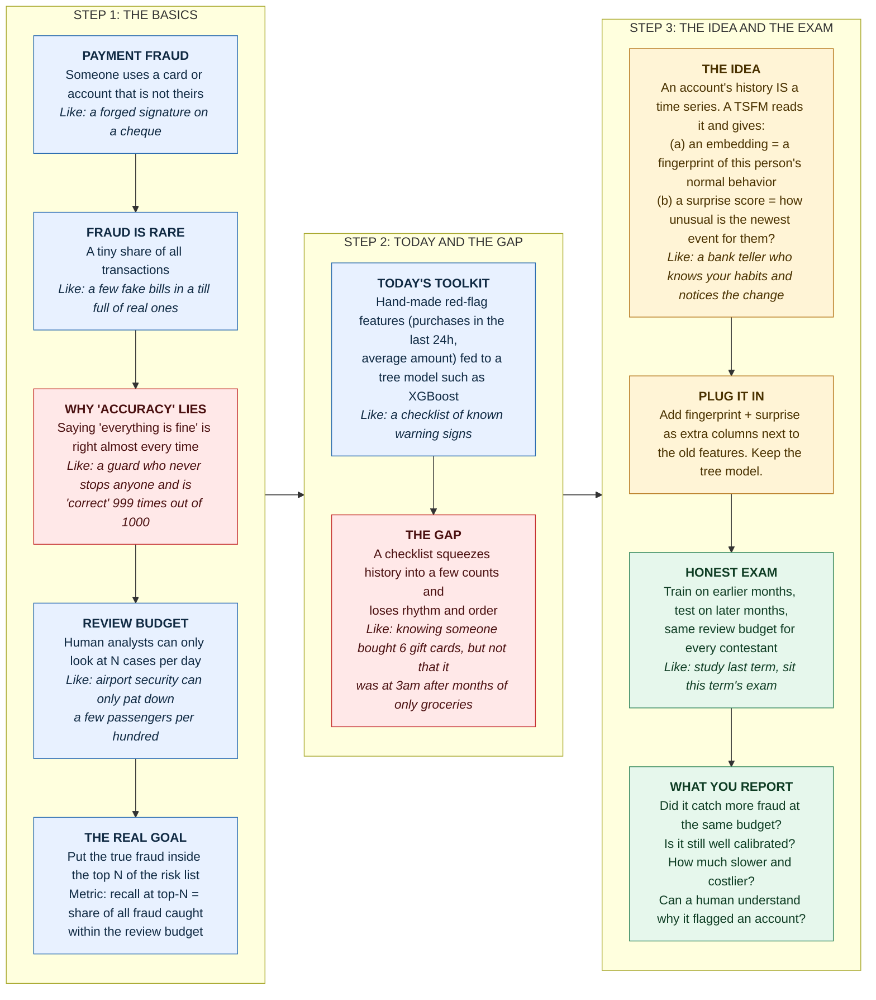
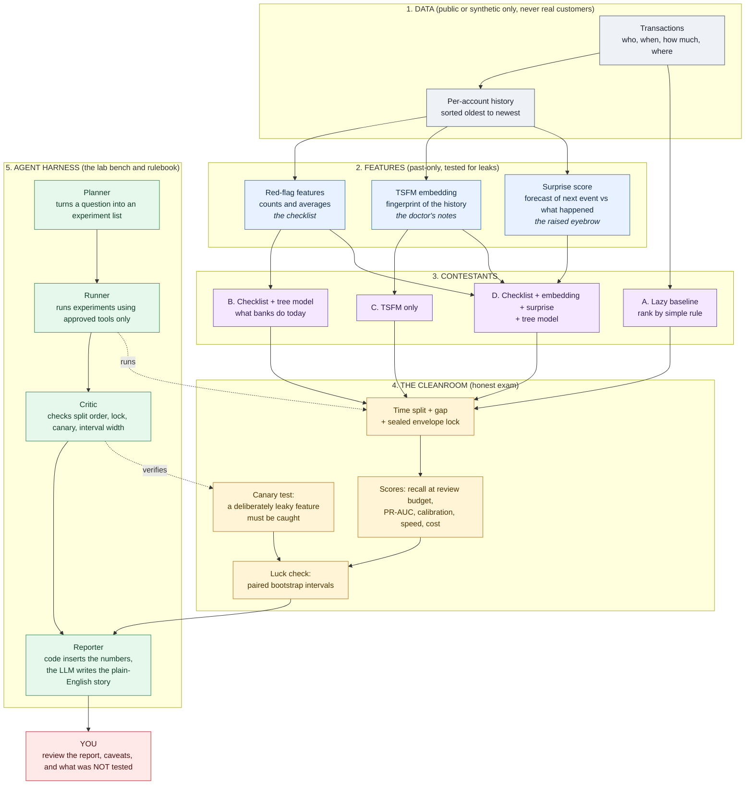

# Tells: PLAN.md

**In one sentence:** Tells tests whether a time series foundation model can help catch fraudulent accounts better than the tools banks already use, under an exam that is built so the model cannot cheat, and it uses an AI agent to run the experiments and write the audit report.

**Why the name:** In poker, a "tell" is a tiny behavior that gives away a hidden hand. A stolen card gives off tells too: odd timing, odd amounts, a sudden change in rhythm. This project tests whether an AI model can read those tells from an account's history.

**Role in your portfolio:** Fraud and risk, the first of three fintech projects (the others are Reserve for credit risk and Culprit for payments). It also builds the shared testing toolkit, called the Cleanroom, that the other two reuse.

## How to use this document

| If you want to... | Read |
|---|---|
| Understand the field from zero | Part 1 (shared basics) then Part 2 |
| See how the system fits together | Part 3 |
| Explain it to a recruiter or friend | Part 4 |
| Know exactly what to build | Part 5 |
| Know what to do each day | Part 6 |
| Stay honest about limits | Part 7 |
| Check where claims come from | Part 8 |

**Diagram images:** every diagram in this file also exists as a PNG in the `diagrams/` folder next to it, with editable Mermaid source in `diagrams/source/`.

---

## Part 1. Start here: the basics, from zero

You do not need any finance or machine learning background to follow this part. Read the diagrams top to bottom. Every box has a plain definition and a real-world analogy.

### Diagram 1. The ladder of ideas (what a "time series foundation model" is, and why testing it honestly is hard)

### Diagram 2. The Cleanroom: how we keep the exam honest

The Cleanroom is the shared testing toolkit every project in this folder uses. The idea is simple: make cheating mechanically impossible, so the results are believable.

```mermaid
flowchart LR
    R["<b>Raw data</b><br/>events with timestamps<br/><i>Like: a long ledger,<br/>oldest entry first</i>"]
    S["<b>Time split</b><br/>Train on the past.<br/>Leave a gap.<br/>Test only on the future<br/><i>Like: study the textbook,<br/>then sit the exam next term</i>"]
    L["<b>Sealed envelope</b><br/>Lock the test plan and a hash of it<br/>BEFORE looking at any score<br/><i>Like: pre-registering a<br/>science experiment</i>"]
    M["<b>Contestants</b><br/>1. Lazy baseline<br/>2. Strong classic model<br/>3. TSFM zero-shot<br/>4. TSFM + classic model<br/><i>Like: a race with a<br/>walker as the control</i>"]
    P["<b>Contamination probe</b><br/>Does the model do suspiciously<br/>better on dates it may have seen?<br/><i>Like: checking if the student<br/>aced only the old questions</i>"]
    T["<b>Is it luck?</b><br/>Statistical tests + multiple-comparison correction<br/><i>Like: a coin that lands heads<br/>3 times is not magic</i>"]
    D["<b>What is it worth?</b><br/>Money-style metric for the domain<br/><i>Like: not 'how accurate',<br/>but 'how many dollars saved'</i>"]
    O["<b>Audit-ready report</b><br/>Numbers, plots, caveats,<br/>and what was NOT tested"]

    R --> S --> L --> M --> P --> T --> D --> O

    classDef step fill:#e8f1ff,stroke:#2b6cb0,color:#102a43;
    classDef lock fill:#fff4d6,stroke:#b7791f,color:#4a3200;
    classDef out fill:#e6f7ec,stroke:#2f855a,color:#0f3d24;
    class R,S,M,P,T,D step;
    class L lock;
    class O out;
```

### Glossary (plain English)

| Term | What it means | Everyday analogy |
|---|---|---|
| Time series | Measurements in time order | A diary of daily step counts |
| Forecast | A guess about future values | Tomorrow's weather |
| Horizon | How far ahead you guess (1 day, 22 days) | "Weather for tomorrow" vs "weather next month" |
| Baseline | The simplest reasonable guess you must beat | "Tomorrow will be like today" |
| Foundation model | A big model pre-trained once on huge, varied data, reused for many tasks | A doctor with a million charts of experience |
| TSFM | A foundation model for time series (examples: Chronos-2, TimesFM, Moirai, TiRex, TTM) | The same doctor, but for numbers over time |
| Zero-shot | Using a model with no extra training on your data | Asking a new patient's question cold |
| Fine-tuning | Brief extra training on your data | Specialty course |
| Embedding | A short list of numbers that summarizes something (here, an account's history) | A fingerprint or a one-line summary of a person |
| Pre-training cutoff | The last date of data a model learned from | The day the textbook was printed |
| Leakage | Future information sneaking into training or testing | Seeing the answer key |
| Contamination | Test data already inside the pre-training data | Exam questions in the textbook |
| Out-of-sample | Data the model never touched while being built | The real exam |
| Calibration | When it says "10% chance", it happens about 10% of the time | A forecaster who says 70% rain and it rains 7 days in 10 |
| Precision / recall | Of the alarms, how many were real / of the real cases, how many did we catch | A smoke alarm: false alarms vs missed fires |
| PR-AUC | One number summarizing precision vs recall when real cases are rare | A report card for a smoke alarm that rarely goes off |
| Statistical test (Diebold-Mariano) | Checks whether one forecaster's win over another is bigger than luck | Is the better free-throw shooter actually better, or just had a good night? |
| Multiple-comparison correction | If you test many ideas, some will look good by chance, so you raise the bar | Buy 100 lottery tickets and one will look like talent |
| Agent | An LLM that picks tools and acts in a loop | An intern who can run experiments |
| Harness | The tools, permissions and rules wrapped around an agent | The lab bench and safety rulebook |
| Orchestration | Coordinating several agent steps or workers | A project manager |
| Pre-registration | Writing down the test plan before seeing results | Sealing the exam rubric in an envelope |

### What the research says, in one honest paragraph

Time series foundation models are not magic for predicting stock returns. In one study, zero-shot Chronos got an out-of-sample R-squared of about -1.37 percent and TimesFM about -2.80 percent on daily returns, which means worse than simply predicting zero ([Re(Visiting) TSFMs in Finance](https://arxiv.org/html/2511.18578v1)). Another found pretrained models beat a random walk with statistical significance in only two asset-model pairs ([Pretrained TSFMs for Financial Return Forecasting](https://arxiv.org/html/2606.27100)). For realized volatility, only one model, TTM, beat the standard econometric benchmark, by roughly 1.3 to 1.8 percent ([Realized volatility with TSFMs](https://arxiv.org/html/2607.05291v1)). Meanwhile, evaluating these models fairly is itself unsolved: a lineage study of 22 TSFMs found only 6 percent of 401 datasets never appeared in any model's pre-training, and leaking just 0.1 percent of held-out data improved error by 8 to 29 points ([TSFM benchmarking challenges](https://arxiv.org/pdf/2510.13654v3)). The live, pre-registered leaderboard that would fix this (TS-Arena) covers energy only so far ([TS-Arena](https://arxiv.org/html/2512.20761v1)). So the opportunity is not "TSFMs beat the market." It is "TSFMs may be useful as feature extractors in risk problems, and almost nobody tests that honestly." That is what these projects do.

---

## Part 2. Fraud, from zero

### Diagram 3. What fraud detection is and where a TSFM could help

**A walk-through in plain words.** Imagine a bank with millions of card transactions a day. Almost all are normal. A few are fraud. The bank has a small team of people who can investigate maybe a few hundred cases a day. So the model's job is not "be accurate." Its job is "sort the list so the fraud lands at the top." That is why we measure how much fraud is caught inside a fixed review budget.

Banks already do this with a checklist-style model. Tells asks one narrow question: if we also give that model a summary of each account's behavior produced by a pretrained time series model, does it catch more fraud at the same budget, and is the result still trustworthy, explainable, and affordable to compute?

**Real-world analogy for the whole project.** A neighborhood bartender notices when a regular suddenly orders differently, comes at a strange hour, and pays in a new way. The bartender never wrote down rules for that. They just know the person's rhythm. A TSFM embedding is a machine version of "knowing someone's rhythm." Tells tests whether that machine bartender is better than the rulebook, and whether we can prove it without fooling ourselves.

---

## Part 3. How Tells works (system diagram)

### Diagram 4. The system, including the agent

**What the agent actually does, and does not do.** The agent is not predicting fraud. The tree model and the TSFM do that. The agent is the lab assistant: it takes a question like "does a longer history window help?", turns it into a list of experiments, runs them with a fixed set of approved tools, checks its own work with the Critic, and drafts the write-up. It cannot read the test labels until the plan is locked in the sealed envelope, which is enforced by code, not by asking nicely. Real-world analogy: a lab technician who is physically unable to open the answer key until the experiment plan has been signed and filed.

**What problem this removes for real firms (my inference, not a verified claim about any firm).** Evaluating a new model for fraud is slow, manual, and easy to do badly: the split might leak, the review budget might be ignored, and the write-up might be assembled by hand. An agent plus a locked-down harness can produce the same audit package every time.

---

## Part 4. How to explain Tells out loud

Fill the brackets only with numbers you actually measured. Never quote a result you have not produced.

### The 10-second version

"I built Tells, a toolkit that tests whether AI models trained on time series can help catch fraud better than what banks use today, plus an agent that runs the experiments and writes the audit report."

### The 30-second version (with the analogy)

"Banks can only investigate a small slice of suspicious transactions each day, so the question is who gets to the top of the list. Today that is a checklist-style model. I'm testing whether adding a pretrained time series model, which acts like a bartender who knows each customer's rhythm, catches more real fraud at the same review budget. The hard part is testing it fairly, so I built a test harness that makes cheating mechanically impossible, and an agent that runs the experiments and drafts the report."

### The 2-minute version (story arc)

1. **The problem.** Fraud is rare and review capacity is limited, so accuracy is the wrong score. What matters is how much fraud lands inside the review budget.
2. **The idea.** Pretrained time series models read an account's history and produce a fingerprint of normal behavior and a surprise score for the latest event. Recent research suggests that adding such summaries helps some financial-crime tasks, but results are not independently validated under strict, budget-aware testing.
3. **What I built.** (a) The Cleanroom: time-ordered splits, a sealed test plan, a planted-leak canary test, luck checks, and calibration. (b) Four contestants from a lazy baseline to checklist plus embeddings. (c) An agent harness with a planner, runner, critic, and reporter.
4. **What I found.** "On AMLWorld at a 0.5% daily review budget, the bank-style model caught [A]% of laundering accounts on their first bad day and adding TSFM features caught [B]% (interval [lo, hi]). On long-history card data the difference was [C]. Calibration was [better/worse]. Embedding cost was [N] ms per account." If the result is negative, say so: "It did not help, and here is the evidence that the test was fair."
5. **What I'd do next.** Try real bank data under an agreement, add more TSFMs, and test how the gain holds up as fraud patterns change over time.

### Versions for different people

| Who | Say this |
|---|---|
| Non-technical friend | "Banks can't check every suspicious payment, so they need to sort them well. I'm testing whether a new kind of AI that learns people's spending rhythm helps, and I built the test so it can't cheat." |
| Recruiter | "It's an applied ML evaluation project in fraud. I own the full pipeline: data, features, modeling, statistical testing, and an agent that automates the experiment and reporting workflow." |
| Hiring manager in fraud or risk | "I focus on the question risk teams actually face: lift at a fixed review capacity, calibration, latency, and explainability, not just AUC." |
| ML interviewer | "Frozen TSFM embeddings plus a surprise score feed a gradient-boosted model. Evaluation uses time-ordered splits with a gap, a pre-registered config hash, paired bootstrap intervals, and a leak canary." |

### Questions you will probably get

**What is a time series foundation model?** A large model pretrained on many different time series so it can handle new ones without being trained from scratch. Think of a doctor who has seen a million charts. Examples include Chronos-2, TimesFM, Moirai, and TiRex.

**Why not just use XGBoost?** I do use it. It is contestant B, the thing banks do today. The project tests whether the TSFM adds value on top of it, and I count the extra cost.

**How do you know there is no leakage?** Four controls: features are built only from the past, the test period comes strictly after training with a gap, the test plan is locked by hash before scoring, and a canary test plants a deliberately leaky feature that the harness must detect. If the canary is not caught, the run fails.

**Why a fixed review budget?** Because analysts have limited time. A model that is great at the 50th percentile of risk but useless at the top 1% is useless in practice.

**What is the agent doing? Is it predicting fraud?** No. It runs the experiments and drafts the report. Numbers in the report are inserted by code. The LLM only writes the narrative around them, so it cannot invent results.

**What data did you use?** Public synthetic datasets, because real bank data is private: IBM's TabFormer credit card transactions as the main one (cards with years of history) and IBM's AMLWorld money-laundering data as the second (the same benchmark the published TSFM paper used). I measured whether each dataset actually has account histories before choosing it, and dropped PaySim because almost every account appears only once. Synthetic data is cleaner than reality, so results are a starting point, not proof.

**What would you do with real data?** Run the same locked protocol on a rolling time window, add monitoring for drift, and involve a model validation team before any use.

**What went wrong, or what surprised you?** Prepare a real answer from your own logs. Good candidates: the first embeddings made things worse, a leak the canary caught, or a result that vanished once you applied the multiple-comparison correction.

### What not to say

- Do not say "it beats bank fraud systems." You tested on public or synthetic data, not a bank's.
- Do not say "it is production-ready."
- Do not say "the TSFM detects fraud by itself." It supplies features to a conventional model.
- Do not quote results from papers as your own.

---

## Part 5. Requirements

### Problem statement

Fraud teams review a limited number of cases and already use gradient-boosted models on hand-built features. Pretrained time series foundation models can summarize an account's transaction history, and early research reports gains for financial-crime detection, but I did not find an independent evaluation that combines strict temporal splits, a fixed analyst-review budget, calibration, and cost, and that is auditable end to end. The main paper reporting TSFM gains on AMLWorld compares against graph neural networks only, with no gradient-boosted tree baseline, and reports PR-AUC rather than catch rate at a review budget ([Savvidi et al. 2026](https://arxiv.org/html/2610.29667v1)). Tells builds that evaluation and automates it with an agent.

### Goals and non-goals

| Goals | Non-goals |
|---|---|
| Honest, repeatable comparison of four contestants | Beating any real bank's system |
| Lift at a fixed review budget with confidence intervals | A production fraud engine |
| Calibration, latency, and cost reported alongside accuracy | Real-time streaming infrastructure |
| An agent that runs experiments and drafts the report under a locked harness | An agent that decides who is fraudulent |
| A reusable Cleanroom package for the other projects | A research paper (not yet) |

### Functional requirements

| ID | Requirement |
|---|---|
| FR1 | Load a public or synthetic transaction dataset into a standard schema (account, time, amount, merchant or counterparty, label), and build account-day cases from it |
| FR2 | Time-ordered split with a configurable gap, asserted by tests |
| FR3 | Past-only feature builder with unit tests proving no future rows are used |
| FR4 | Four contestants: lazy baseline, checklist plus tree model, TSFM only, checklist plus embedding plus surprise score plus tree model |
| FR5 | At least two TSFMs behind one adapter interface (verify at build time which expose embeddings) |
| FR6 | Metrics: recall at a daily review budget on account-day cases, caught-on-first-fraud-day rate, transaction-level PR-AUC, Brier score, reliability curve, latency per account, compute cost |
| FR7 | Paired bootstrap intervals for differences between contestants |
| FR8 | Sealed-envelope lock: config hash recorded before test scoring, scoring refuses to run without it |
| FR9 | Canary leak test that the harness must catch |
| FR10 | Explainability: SHAP on features plus example accounts that show what the embedding captured |
| FR11 | Agent harness with Planner, Runner, Critic, Reporter and a tool allow-list |
| FR12 | Report generator where all numbers come from result files, never from the LLM |
| FR13 | One-command reproduction of the headline table on a small data subset |
| FR14 | Multiple-comparison correction (Holm, plus Benjamini-Hochberg as a secondary view) across all contestants and variants, with the count of variants tried |
| FR15 | Contamination note: each TSFM's documented pretraining cutoff and corpus (or "undisclosed") next to each dataset's release date |

### Data (measured on 2026-11-10, details in `docs/data-fit.md`)

| Role | Dataset | Why |
|---|---|---|
| Secondary (long history) | IBM TabFormer synthetic credit card transactions (GitHub, free, no account) | 6,139 cards, 1991 to 2020, median 1,493 transactions before a card's first fraud. Real account histories to read, but the bank-style model is near the ceiling here. |
| Main test | AMLWorld HI-Small (Kaggle, free account) | The benchmark the TSFM paper used, so results can be compared. Thin history: median 9 prior events. Truncate to 2022-09-01 through 2022-09-10; after that the data is about 60% laundering, a generator artifact. |
| Set aside | IEEE-CIS, PaySim, Sparkov | IEEE-CIS and PaySim have no usable account histories (measured); Sparkov is another card simulator, so it adds little variety. Details in `docs/data-fit.md`. |

Why this pair: both are free, and they differ on every axis that matters for the question. TabFormer is card fraud with decades of history per card; AMLWorld is money laundering with days of history per account and a published TSFM result to compare against. If the TSFM helps on one and not the other, history length is the first explanation to test.

Never commit raw data to git. Store download scripts and checksums instead. Run `scripts/check_data_fit.py` on any new dataset before writing a loader for it.

### Scoring unit

Each account active on a day is one case. A case's score is the highest score among its transactions that day, and its label is 1 if any of them is labeled. The review budget is a share of each day's cases (0.1%, 0.5%, 1%, 2%, 5%). The headline metric is the first-fraud-day catch rate at a 0.5% daily budget; every other metric is reported next to it. Transaction-level PR-AUC is also reported for comparison with published AMLWorld results. Reasons for every choice: `docs/methodology.md`.

### Evaluation protocol

1. Fix the time split and gap in a config file.
2. Lock the config hash.
3. Run all four contestants on identical splits and identical review budgets (for example 0.5, 1, 2, and 5 percent of accounts).
4. Report recall at each budget with bootstrap intervals, calibration, and cost.
5. Run the canary and a time-shuffled control. The shuffled control should destroy the signal. If it does not, something leaks.
6. Apply multiple-comparison correction across every contestant and variant tried, and report the count.
7. Report results per test period as well as pooled, because TabFormer's fraud rate swings a lot from year to year.
8. Report negative results as clearly as positive ones.

### Agent design

- **Planner:** converts a research question in YAML into a list of experiment configs.
- **Runner:** can call only approved tools (`run_experiment`, `load_results`, `plot`). It has no file-system or network access beyond them.
- **Critic:** deterministic checks first (split order, lock present, canary caught, interval width), an LLM review second.
- **Reporter:** a template fills numbers from result files. The LLM writes only the narrative and must quote numbers by reference.
- **Human review:** you read the report before anything is published.
- Keep LLM calls behind an interface and record them as cassettes so tests are deterministic and free.

### Non-functional requirements

- Python 3.11 or newer, managed with `uv`. Lint with `ruff`. Tests with `pytest`.
- Fixed random seeds, pinned dependency versions, recorded model versions.
- The small-subset run finishes on a laptop CPU in under 15 minutes. The full run may use a GPU (for example free Colab), recorded in the run log.
- The Cleanroom is its own package (`packages/cleanroom`) in a uv workspace, released by git tag, installable by Reserve and Culprit.
- Every result carries its config hash, git commit, model version, and data checksum.

### Definition of done for v0.1

- The four contestants run end to end on TabFormer and AMLWorld HI-Small.
- The Cleanroom rejects a deliberately leaky run (canary) and refuses to score without a lock.
- The agent produces a report from a one-line question with no manual editing of numbers.
- The README contains Diagrams 1 to 4, a quickstart in five commands or fewer, the headline table, and a "limits" section.
- You can give the 2-minute pitch without notes.

---

## Part 6. The 30-day plan (one shippable feature per day)

Each row should end in a merged commit with a test. If a day slips, drop the next "nice to have", not the test.

### Phase 0 (done 2026-11-10): decisions and data fit

Decisions D1 to D5 in `docs/decisions.md`; reasons for every method in `docs/methodology.md`; measured dataset fit in `docs/data-fit.md`; `scripts/check_data_fit.py`; repo at https://github.com/BK5102/tells. Owner actions still to do before they are needed: a free Kaggle account for the official AMLWorld download (Day 27) and an Anthropic API key in `.env` (Day 22).

### Days 1 to 11: build the Cleanroom (the shared package)

| Day | Ship |
|---|---|
| 1 | Repo scaffold as a uv workspace: root package `tells` plus `packages/cleanroom` as its own package. `ruff`, `pytest`, CI that tests both. README skeleton with Diagram 1. |
| 2 | TabFormer loader into the standard schema, a small-subset sampler (a few hundred cards), and the account-day case builder, with schema tests. |
| 3 | `cleanroom.split`: time-ordered split with a gap. Test asserts latest train time is before earliest test time. Design it so Reserve's rolling origins and Culprit's context period can be added without breaking callers. |
| 4 | Lazy baseline contestant and the scoring harness skeleton. |
| 5 | Metrics: recall at a daily review budget, caught-on-first-fraud-day, PR-AUC. Tests against hand-computed examples. |
| 6 | Calibration: Brier score and reliability curve. |
| 7 | Past-only feature builder (rolling counts, amount statistics) plus leak unit tests. |
| 8 | Strong baseline contestant (LightGBM) with typed config, run log, and the provenance stamp (config hash, git commit, data checksum). |
| 9 | Sealed-envelope lock: config hash recorded before test scoring. Scoring refuses without it. |
| 10 | Paired bootstrap intervals (resampling by account) and multiple-comparison correction (Holm, Benjamini-Hochberg). |
| 11 | Generic canary: plant a feature built from future rows and assert the harness flags it. Run the leak audit prompt. Tag `cleanroom-v0.1` and prove it installs from git into an empty folder. |

### Days 12 to 20: add the TSFMs

| Day | Ship |
|---|---|
| 12 | Spike: which TSFMs expose embeddings or hidden states and run on CPU? Start with Chronos-2 (used by the AMLWorld paper) and check its own docs. Write findings in `docs/tsfm-notes.md` and pick two. |
| 13 | Convert account histories into model-ready sequences. Default: one step per transaction with parallel channels (amount, time gap since previous transaction, merchant category, direction), as in the AMLWorld paper, plus a daily-resampled variant to compare. Tests. |
| 14 | First TSFM adapter with embedding extraction and an on-disk cache keyed by model, version, account, and cutoff. |
| 15 | Contestant D: checklist plus embedding feeding the tree model. |
| 16 | Surprise score: forecast the next event, compare with the actual, add as a feature. |
| 17 | Second TSFM adapter behind the same interface. |
| 18 | Wire the canary and a time-shuffled control into every experiment. Add the contamination note (FR15). |
| 19 | Explainability: SHAP on features plus nearest-neighbor example accounts. |
| 20 | Cost and latency measurement per account, batch versus cached. Leak audit prompt. |

Ablations (context length, embedding size via PCA, frozen only) move into the Day 26 grid as configs, since they need no new code.

### Days 21 to 30: the agent, the results, the story

| Day | Ship |
|---|---|
| 21 | Typed tool layer for the agent: `run_experiment`, `load_results`, `plot`. |
| 22 | Planner plus Runner v0 with an allow-list and no access to test labels before the lock. |
| 23 | Critic: deterministic checks, then LLM review. |
| 24 | Reporter: template inserts numbers from result files, the LLM writes the narrative only. |
| 25 | Guardrail tests: a peek-at-test-labels attempt must be denied. Record LLM calls as cassettes. |
| 26 | Run the full experiment grid on AMLWorld (the main test), including the ablation configs. Store artifacts. Leak audit prompt. |
| 27 | Replicate the grid on TabFormer (the long-history case) and compare by history length (M23). |
| 28 | Write "Findings and limits", including negative results. |
| 29 | README polish: diagrams, pitch, quickstart, a terminal recording. |
| 30 | Tag v0.1. Post a short build-in-public write-up (not a paper). Open three "good first issue" tickets. |

---

## Part 7. Risks and honesty rules

| Risk | What to do |
|---|---|
| Synthetic data is cleaner than reality | Say so in the README. Replicate on a second dataset. Never claim real-world performance. In TabFormer, 44.8% of cards see fraud at some point, far more than in reality. |
| A dataset artifact looks like a signal | AMLWorld's last days are about 60% laundering. Truncate them, and keep the time-shuffled control. |
| The test period is unusually easy or hard | TabFormer fraud counts swing by year. Lock the test period before results, and report per period. |
| Accounts have too little history | Run `scripts/check_data_fit.py` first. On AMLWorld, report results separately for accounts with fewer than 16 prior events. |
| Embeddings add nothing | That is a valid, publishable-on-GitHub result. Show the evidence that the test was fair. |
| Many small experiments produce a lucky win | Apply multiple-comparison correction and report how many variants you tried. |
| The LLM invents numbers in the report | Numbers come only from code. Fail the build if a number in the report is not in the results file. |
| TSFM license or access changes | Record model name, version, and license in the run log. |
| A vendor claim leaks into your pitch | Quote only results you produced. Label papers as "reported by". |
| Scope creep into a paper or a product | Not yet. Ship v0.1 first. |

---

## Part 8. Sources

- [Leveraging Time-Series Foundation Models for Financial Crime Detection](https://arxiv.org/abs/2610.29667) (Savvidi et al., October 2026): frozen Chronos-2 embeddings of each account's raw transaction sequence beat the strongest graph neural network baseline by about 10.8 percent relative PR-AUC on five of six AMLWorld datasets, scored per transaction. No gradient-boosted tree baseline, no review budget, no code linked.
- [Realistic Synthetic Financial Transactions for Anti-Money Laundering Models](https://arxiv.org/abs/2306.16424) (Altman et al., NeurIPS 2023): the AMLWorld datasets.
- [Tabular Transformers for Modeling Multivariate Time Series](https://arxiv.org/abs/2011.01843) (Padhi et al., 2021) and [IBM/TabFormer](https://github.com/IBM/TabFormer): the synthetic credit card dataset.
- [Chronos-2](https://arxiv.org/abs/2510.15821): the first TSFM to check on Day 12.
- [Sardine: foundation models for card issuer fraud](https://www.sardine.ai/blog/foundation-model-issuer-fraud-detection): vendor claim of 24 to 35 percent more fraud caught at the same flag rate. Not independently validated, and its own figures are internally inconsistent, so treat it as motivation only.
- [TSFM benchmarking challenges and leakage](https://arxiv.org/pdf/2510.13654v3): why evaluation needs a global test period after all training cutoffs.
- [TS-Arena](https://arxiv.org/html/2512.20761v1): pre-registered live evaluation, energy only so far.
- [Reported Alpha from LLM Trading Agents Should Not Be Read as Deployment Evidence](https://arxiv.org/pdf/2605.16895): the minimum-evidence mindset (temporal integrity, calibration, realistic costs) that this project borrows.
- [Re(Visiting) Time Series Foundation Models in Finance](https://arxiv.org/html/2511.18578v1), [Pretrained TSFMs for Financial Return Forecasting](https://arxiv.org/html/2606.27100), [Realized volatility with TSFMs](https://arxiv.org/html/2607.05291v1): why TSFMs are not a free lunch for market prediction.
- [TimeCopilot](https://arxiv.org/html/2509.00616v3): open-source example of an agent orchestrating TSFMs (it does not handle finance-specific leakage or costs).
