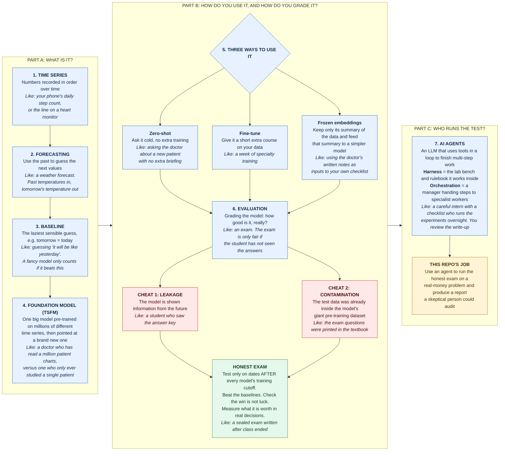

# Tells

**Does a pretrained time series model help catch fraud and money laundering when analysts can only review a small, fixed number of cases each day?** Tells answers that with an evaluation built so no model can cheat, and every choice in it is written down with its reason and its limits.

In poker, a "tell" is a small behavior that gives away a hidden hand. A stolen card or a mule account gives off tells too: odd timing, odd amounts, a sudden change in rhythm. Tells tests whether a time series foundation model (TSFM), a model pretrained on millions of time series, can read those tells from an account's history and add value on top of the checklist-plus-tree-model approach banks use today.

> **Status (2026-11-14):** the honest-exam toolkit (the Cleanroom, released as `cleanroom-v0.1`) and the two baseline contestants are built and tested (135 tests). The TSFM contestants C and D are built; their validation runs are in progress. Every number below is from the **validation** period, used to check the pipeline and choose the headline metric. **No test-period result exists yet**: the test period stays locked until the full plan is sealed.

## The problem in one paragraph

Fraud is rare (about 1 in 1,000 transactions here), so "accuracy" is meaningless: a model that says "everything is fine" is 99.9% accurate and useless. Analysts can only open a small share of cases per day. So the real question is: **of the accounts that just went bad, how many land inside today's review queue?** Tells measures exactly that, on the day each account first goes bad, because that catch is what stops further losses.

## The idea in one diagram



## How the exam is kept honest

```mermaid
flowchart LR
    R["<b>Raw data</b><br/>events with timestamps<br/><i>Like: a long ledger,<br/>oldest entry first</i>"]
    S["<b>Time split</b><br/>Train on the past.<br/>Leave a gap.<br/>Test only on the future<br/><i>Like: study the textbook,<br/>then sit the exam next term</i>"]
    L["<b>Sealed envelope</b><br/>Lock the test plan and a hash of it<br/>BEFORE looking at any score<br/><i>Like: pre-registering a<br/>science experiment</i>"]
    M["<b>Contestants</b><br/>1. Lazy baseline<br/>2. Strong classic model<br/>3. TSFM zero-shot<br/>4. TSFM + classic model<br/><i>Like: a race with a<br/>walker as the control</i>"]
    P["<b>Contamination probe</b><br/>Does the model do suspiciously<br/>better on dates it may have seen?<br/><i>Like: checking if the student<br/>aced only the old questions</i>"]
    T["<b>Is it luck?</b><br/>Statistical tests + multiple-comparison correction<br/><i>Like: a coin that lands heads<br/>3 times is not magic</i>"]
    D["<b>What is it worth?</b><br/>Money-style metric for the domain<br/><i>Like: not 'how accurate',<br/>but 'how many dollars saved'</i>"]
    O["<b>Audit-ready report</b><br/>Numbers, plots, caveats,<br/>and what was NOT tested"]

    R --> S --> L --> M --> P --> T --> D --> O

    classDef step fill:#e8f1ff,stroke:#2b6cb0,color:#102a43;
    classDef lock fill:#fff4d6,stroke:#b7791f,color:#4a3200;
    classDef out fill:#e6f7ec,stroke:#2f855a,color:#0f3d24;
    class R,S,M,P,T,D step;
    class L lock;
    class O out;
```



| Safeguard | What it does | Why | Proven by |
|---|---|---|---|
| Time split with a gap | Train on the past, skip a gap, test on the future | A model is used on the future; the gap stands in for the delay before fraud is reported | `cleanroom.split`; a test smuggles a test row into training and confirms it is caught |
| Past-only features | Every feature uses only strictly earlier transactions; same-minute transactions never see each other | At scoring time, later transactions do not exist | `cleanroom.pastonly` rebuilds features from data cut at each probe and demands an exact match; a planted bug was caught |
| Canary | Every run plants two cheats (a peek at the next transaction, a peek at the next label) and refuses to report unless both are caught | Proves the leak checks work on the data being reported | `cleanroom.canary`; it exposed its own blind spot on the first day |
| Sealed envelope | The plan is hashed and committed before any test score exists; test scoring refuses without it; every test run is counted | Nobody can change the split or metric after seeing results | `cleanroom.lock`; an edited lock file is rejected |
| Luck check | Paired bootstrap over whole accounts, Holm and Benjamini-Hochberg corrections | A win must be bigger than chance, and an account's days belong together | `cleanroom.bootstrap`, `cleanroom.stats` |
| Provenance | Every result stores config hash, git commit, data checksum, library versions; every run is logged forever | Every number must trace back to exact inputs, and runs that did not help stay on record | `cleanroom.provenance`, `artifacts/runs/index.jsonl` |

The Cleanroom is a separate, domain-neutral package so the sibling projects (credit risk and payments) sit the same exam: `uv add "cleanroom @ git+https://github.com/BK5102/tells@cleanroom-v0.1#subdirectory=packages/cleanroom"`.

## Data, and why these two datasets

| Role | Dataset | Why it is here | Its main limit |
|---|---|---|---|
| **Main test** | [AMLWorld](https://arxiv.org/abs/2306.16424) HI-Small: synthetic money laundering, 5.08 million transfers, 515,088 accounts, 10 usable days | The bank-style model is far from perfect here, so a TSFM gain can show. It is the benchmark a [published TSFM paper](https://arxiv.org/html/2610.29667v1) used. Accounts have short histories (median 9 events before laundering) | Only ten usable days; the last days of the file are an artifact and are removed |
| **Long-history test** | [IBM TabFormer](https://github.com/IBM/TabFormer): synthetic card transactions, 24.4 million, 6,139 cards, 1991 to 2020 | Cards have years of history (median 1,493 transactions before the first fraud), the opposite case | The bank-style model is near the ceiling, so its headline uses the tightest budget |

IEEE-CIS, PaySim, and Sparkov were measured and set aside: IEEE-CIS and PaySim have no usable account histories (the median account appears once), and Sparkov is another card simulator. Evidence: [`docs/data-fit.md`](docs/data-fit.md).

## How a result is scored

- **Unit:** an account-day case, one per account per active day, scored by its most suspicious transaction that day. Analysts review accounts, not rows.
- **Budget:** a share of each day's cases: 0.1%, 0.5%, 1%, 2%, 5%. Ties at the cutoff share the remaining slots, so tie order cannot help a model.
- **Headline metric:** the **first-fraud-day catch rate**: of the accounts that go bad for the first time, the share caught on that first day. Budget 0.5% on AMLWorld, 0.1% on TabFormer (at 0.5% the bank-style model already catches about 91% of TabFormer cases). Accounts already known to be bad are left out of the headline.
- **Always reported next to it:** recall and precision at every budget, PR-AUC per case and per transaction, calibration (Brier score against the base rate), fit and scoring time.

## Contestants

| | Contestant | What it is | Status |
|---|---|---|---|
| A | Lazy baseline | Rank by amount, no learning. Any model must beat this | Built |
| B | Checklist + LightGBM | 34 past-only red-flag features (activity bursts, unusual amounts, new merchants or counterparties, money in versus out) into a gradient-boosted tree model: roughly what banks use | Built |
| C | TSFM only | LightGBM on the TSFM's 16-number summary of each account's history plus two surprise scores, nothing else | Built (TTM, Chronos-2) |
| D | B + TSFM | Contestant B's columns plus the TSFM columns, with B's exact model settings, so only the inputs differ | Built (TTM, Chronos-2) |

The TSFMs are [Chronos-2](https://arxiv.org/abs/2510.15821) (119.5M parameters, the model the AMLWorld paper used) and IBM's [TTM r2](https://huggingface.co/ibm-granite/granite-timeseries-ttm-r2) (0.8M parameters, a different lab and design). There is no GPU, so TTM runs on full data and Chronos-2 on the 20,000-account AMLWorld sample, where a CPU can finish (see [`docs/tsfm-notes.md`](docs/tsfm-notes.md)).

Stated before testing: if the TSFM helps, the gain should be larger on AMLWorld than on TabFormer, and results will be split by history length (fewer than 16 prior events versus 16 or more).

## Results so far (validation period only, contestants A and B)

These are development checks on the validation period, not findings: contestants C and D do not exist yet, and the test period is still locked. Numbers are copied from the run files named below.

| Validation period | AMLWorld (main test), 2022-09-06 | TabFormer (long history), 2016 |
|---|---|---|
| Account-day cases / newly bad accounts | 224,616 / 672 | 839,604 / 556 |
| **Headline: first-fraud-day catch** | budget 0.5% | budget 0.1% |
| A. Lazy baseline | 2.1% | 0.7% |
| B. Checklist + LightGBM | **31.5%** | **28.4%** |
| B minus A, 95% interval (1,000 account resamples) | -29.5 points [-33.0, -25.9]: B is far ahead | -27.8 points [-31.5, -24.2] |
| B at 0.5% / 1% / 5% budget | 31.5% / 46.0% / 83.0% | 90.1% / 96.0% / 99.1% |
| B transaction PR-AUC | 0.409 | 0.842 |
| B Brier score (base rate) | 0.00094 (0.00110) | 0.00067 (0.00209) |
| B fit / score time on CPU | 171 s / 59 s | 706 s / 66 s |

What this says: the bank-style model is a strong, well-calibrated baseline on card data and leaves about two thirds of new laundering accounts uncaught at a 0.5% budget, so AMLWorld is where a TSFM has room to help. On AMLWorld, B's transaction PR-AUC (0.41) is below the published graph-based models (0.74 to 0.78, [Savvidi et al. 2026](https://arxiv.org/html/2610.29667v1)), as expected for a model without graph features and on a different split.

Runs: `20261115T020923Z_amlworld_valid_5152975d_4396a0` (commit `b807bfb`, clean) and `20261115T021607Z_tabformer_valid_44c6db59_66d055` (commit `b807bfb`; marked as having uncommitted changes because documentation files were being edited while it started, with no code changes). Both runs passed the canary.

## Problems found and fixed along the way

These are the moments that made the evaluation more trustworthy:

1. **A fake signal in the data.** The last eight days of AMLWorld are about 60% laundering against 0.1% before, a generator artifact. Any model would have scored well by learning "late date means laundering". Removed.
2. **A dataset that could not test the idea.** IEEE-CIS looked ideal (real, anonymized), but after rebuilding account ids the median account appears once, and 66% of later transactions on a fraud account are labeled fraud, a sign labels were copied forward. Set aside.
3. **A metric that was too easy.** On TabFormer the bank-style model caught about 96% of fraud cases at a 1% budget, leaving no room to see a gain. Added a 0.1% budget and made AMLWorld the main test.
4. **A headline that counted old news.** "First fraud day" first counted accounts already known to be bad before the period: 19% of AMLWorld and 46% of TabFormer positives. Fixed to count only new catches.
5. **A biased luck check.** The first bootstrap re-ranked each resample, so duplicated accounts competed for the same review slots and one interval did not contain its own estimate. Fixed by forming the queue once on real data; every result now reports the bootstrap mean so this bias would be visible.
6. **A blind canary.** The first canary sample on AMLWorld had no laundering accounts, so a label leak could not be detected. The sample now always includes positive accounts, and the Cleanroom refuses a sample that cannot catch it.
7. **A flaky CI test.** Two runs starting in the same second shared a folder on fast CI machines. Run folders now get a unique suffix and still refuse to overwrite.

## Limitations

The short list. The full register, with what was done about each, is in [`docs/methodology.md`](docs/methodology.md#limitations-register).

- Synthetic data only, from two IBM generators. Nothing here shows how a model performs at a real bank.
- AMLWorld has ten usable days, so gaps are one day and validation is a single day; intervals will be wide.
- The gaps (90 days for cards, 1 day for laundering) are assumptions about label delay.
- Contestant B has no graph features, so it is weaker than the best published AMLWorld models. It does have money-movement red flags, so it is a fair baseline, not a strawman.
- The AMLWorld copy is a mirror whose counts match the paper; the comparison with the official Kaggle checksum is still to do.
- This is not a production system. The agent planned for later runs experiments and drafts reports; it never decides who is fraudulent.

## Quickstart

```
uv sync --all-packages
uv run pytest -q                                   # 135 tests; data tests skip without data
uv run tells prepare tabformer                     # after downloading (see data/README.md)
uv run tells prepare amlworld
uv run tells run configs/amlworld_small.yaml       # 20,000-account sample, about 15 seconds
```

`uv run tells run configs/amlworld.yaml` runs the full main test on the validation period. Scoring the test period needs `uv run tells lock <config>` first.

## Where things are

| Path | What |
|---|---|
| [`docs/methodology.md`](docs/methodology.md) | **Every choice: what, why, what else was considered, limitation.** Start here to understand the project |
| [`docs/decisions.md`](docs/decisions.md) | Dated diary of what was built and why, in plain English with analogies |
| [`docs/data-fit.md`](docs/data-fit.md) | Measured fit of every candidate dataset |
| [`docs/audits/`](docs/audits/) | Leak audits with PASS / FAIL per check |
| [`PLAN.md`](PLAN.md) | Background from zero, requirements, the 30-day plan |
| `packages/cleanroom/` | The shared honest-exam toolkit |
| `src/tells/` | Loaders, features, contestants, harness, evaluation |
| `configs/` | Experiment configs; the split, budgets, and headline are fixed here |

## Progress

| Phase | Days | Status |
|---|---|---|
| 0. Decisions and data fit | | Done |
| 1. Repo, data loaders, time split | 1 to 3 | Done |
| 2. Scoring harness, metrics, features, bank-style model | 4 to 8 | Done |
| 3. Lock, luck checks, canary, Cleanroom v0.1 | 9 to 11 | Done |
| 4. TSFM contestants | 12 to 17 | Built; validation runs in progress |
| 5. Controls, explainability, cost | 18 to 20 | |
| 6. Agent harness | 21 to 25 | |
| 7. Full grid, findings, write-up | 26 to 30 | |
