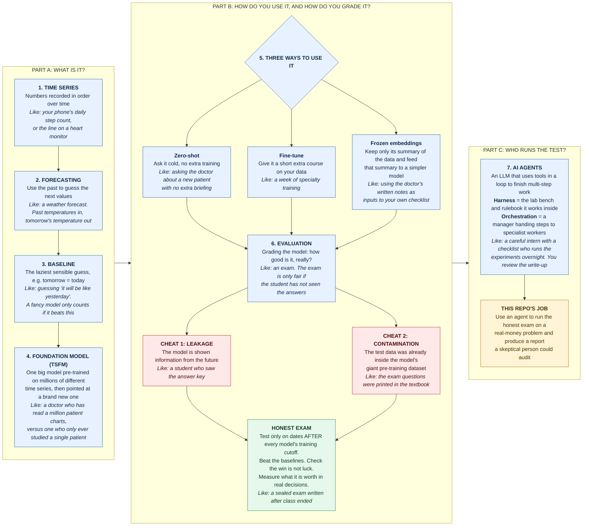

# Tells

**Does a pretrained time series model help catch fraud and money laundering when analysts can only review a small, fixed number of cases each day?** Tells answers that with an evaluation built to catch cheating, and every choice in it is written down with its reason and its limits.

In poker, a "tell" is a small behavior that gives away a hidden hand. A stolen card or a mule account gives off tells too: odd timing, odd amounts, a sudden change in rhythm. Tells tests whether a time series foundation model (TSFM), a model pretrained on millions of time series, can read those tells from an account's history and add value on top of the checklist-plus-tree-model approach banks use today.

> **Status (2026-11-16):** the honest-exam toolkit (the Cleanroom, released as `cleanroom-v0.1`), all four contestants (two TSFMs: TTM and Chronos-2), the label-permutation control, SHAP explanations, the report generator, and the agent's tools, loop, and critic are built and tested (165 tests). The AMLWorld test period has been scored once under a sealed plan; its result is below. The TabFormer test is sealed and running.

## The problem in one paragraph

Fraud is rare (about 1 in 1,000 transactions here), so "accuracy" is meaningless: a model that says "everything is fine" is 99.9% accurate and useless. Analysts can only open a small share of cases per day. So the real question is: **of the accounts that just went bad, how many land inside today's review queue?** Tells measures exactly that, on the day each account first goes bad, because that catch is what stops further losses.

## The idea in one diagram



## How the exam is kept honest

```mermaid
flowchart LR
    R["<b>Raw data</b><br/>events with timestamps<br/><i>Like: a long ledger,<br/>oldest entry first</i>"]
    S["<b>Time split</b><br/>Train on the past.<br/>Leave a gap.<br/>Test only on the future<br/><i>Like: study the textbook,<br/>then sit the exam next term</i>"]
    L["<b>Sealed envelope</b><br/>Lock the test plan and a hash of it<br/>BEFORE looking at any score<br/><i>Like: pre-registering a<br/>science experiment</i>"]
    M["<b>Contestants</b><br/>1. Lazy baseline<br/>2. Strong classic model<br/>3. TSFM zero-shot<br/>4. TSFM + classic model<br/><i>Like: a race with a<br/>walker as the control</i>"]
    P["<b>Contamination probe</b><br/>Does the model do suspiciously<br/>better on dates it may have seen?<br/><i>Like: checking if the student<br/>aced only the old questions</i>"]
    T["<b>Is it luck?</b><br/>Statistical tests + multiple-comparison correction<br/><i>Like: a coin that lands heads<br/>3 times is not magic</i>"]
    D["<b>What is it worth?</b><br/>Money-style metric for the domain<br/><i>Like: not 'how accurate',<br/>but 'how many dollars saved'</i>"]
    O["<b>Audit-ready report</b><br/>Numbers, plots, caveats,<br/>and what was NOT tested"]

    R --> S --> L --> M --> P --> T --> D --> O

    classDef step fill:#e8f1ff,stroke:#2b6cb0,color:#102a43;
    classDef lock fill:#fff4d6,stroke:#b7791f,color:#4a3200;
    classDef out fill:#e6f7ec,stroke:#2f855a,color:#0f3d24;
    class R,S,M,P,T,D step;
    class L lock;
    class O out;
```



| Safeguard | What it does | Why | Proven by |
|---|---|---|---|
| Time split with a gap | Train on the past, skip a gap, test on the future | A model is used on the future; the gap stands in for the delay before fraud is reported | `cleanroom.split`; a test smuggles a test row into training and confirms it is caught |
| Past-only features | Every feature uses only strictly earlier transactions; same-minute transactions never see each other | At scoring time, later transactions do not exist | `cleanroom.pastonly` rebuilds features from data cut at each probe and demands an exact match; a planted bug was caught |
| Canary | Every run plants two cheats (a peek at the next transaction, a peek at the next label) and refuses to report unless both are caught | Proves the leak checks work on the data being reported | `cleanroom.canary`; it exposed its own blind spot on the first day |
| Sealed envelope | The plan is hashed and committed before any test score exists; test scoring refuses without it; every test run is counted | Nobody can change the split or metric after seeing results | `cleanroom.lock`; an edited lock file is rejected |
| Luck check | Paired bootstrap over whole accounts, Holm and Benjamini-Hochberg corrections | A win must be bigger than chance, and an account's days belong together | `cleanroom.bootstrap`, `cleanroom.stats` |
| Provenance | Every result stores config hash, git commit, data checksum, library versions; every run is logged forever | Every number must trace back to exact inputs, and runs that did not help stay on record | `cleanroom.provenance`, `artifacts/runs/index.jsonl` |

The Cleanroom is a separate, domain-neutral package so the sibling projects (credit risk and payments) sit the same exam: `uv add "cleanroom @ git+https://github.com/BK5102/tells@cleanroom-v0.1#subdirectory=packages/cleanroom"`.

## Data, and why these two datasets

| Role | Dataset | Why it is here | Its main limit |
|---|---|---|---|
| **Main test** | [AMLWorld](https://arxiv.org/abs/2306.16424) HI-Small: synthetic money laundering, 5.08 million transfers, 515,088 accounts, 10 usable days | The bank-style model is far from perfect here, so a TSFM gain can show. It is the benchmark a [published TSFM paper](https://arxiv.org/html/2610.29667v1) used. Accounts have short histories (median 9 events before laundering) | Only ten usable days; the last days of the file are an artifact and are removed |
| **Long-history test** | [IBM TabFormer](https://github.com/IBM/TabFormer): synthetic card transactions, 24.4 million, 6,139 cards, 1991 to 2020 | Cards have years of history (median 1,493 transactions before the first fraud), the opposite case | The bank-style model is near the ceiling, so its headline uses the tightest budget |

IEEE-CIS, PaySim, and Sparkov were measured and set aside: IEEE-CIS and PaySim have no usable account histories (the median account appears once), and Sparkov is another card simulator. Evidence: [`docs/data-fit.md`](docs/data-fit.md).

## How a result is scored

- **Unit:** an account-day case, one per account per active day, scored by its most suspicious transaction that day. Analysts review accounts, not rows.
- **Budget:** a share of each day's cases: 0.1%, 0.5%, 1%, 2%, 5%. Ties at the cutoff share the remaining slots, so tie order cannot help a model.
- **Headline metric:** the **first-fraud-day catch rate**: of the accounts that go bad for the first time, the share caught on that first day. Budget 0.5% on AMLWorld, 0.1% on TabFormer (at 0.5% the bank-style model already catches about 91% of TabFormer cases). Accounts already known to be bad are left out of the headline.
- **Always reported next to it:** recall and precision at every budget, PR-AUC per case and per transaction, calibration (Brier score against the base rate), fit and scoring time.

## Contestants

| | Contestant | What it is | Status |
|---|---|---|---|
| A | Lazy baseline | Rank by amount, no learning. Any model must beat this | Built |
| B | Checklist + LightGBM | 34 past-only red-flag features (activity bursts, unusual amounts, new merchants or counterparties, money in versus out) into a gradient-boosted tree model: roughly what banks use | Built |
| C | TSFM only | LightGBM on the TSFM's 16-number summary of each account's history plus two surprise scores, nothing else | Built (TTM, Chronos-2) |
| D | B + TSFM | Contestant B's columns plus the TSFM columns, with B's exact model settings, so only the inputs differ | Built (TTM, Chronos-2) |

The TSFMs are [Chronos-2](https://arxiv.org/abs/2510.15821) (119.5M parameters, the model the AMLWorld paper used) and IBM's [TTM r2](https://huggingface.co/ibm-granite/granite-timeseries-ttm-r2) (0.8M parameters, a different lab and design). There is no GPU, so TTM runs on full data and Chronos-2 on the 20,000-account AMLWorld sample, where a CPU can finish (see [`docs/tsfm-notes.md`](docs/tsfm-notes.md)).

Stated before testing: if the TSFM helps, the gain should be larger on AMLWorld than on TabFormer, and results will be split by history length (fewer than 16 prior events versus 16 or more).

## Main result: sealed AMLWorld test

**On the sealed AMLWorld test period, adding a time series foundation model (TTM) to the bank-style model did not catch more newly bad accounts on their first bad day at a 0.5% daily review budget: 34.5% against 34.4%, a difference of +0.1 points (95% interval -1.6 to +1.9, Holm-corrected p 0.94), across 1,798 newly bad accounts.**

The plan was sealed by hash and committed before scoring (lock `f6ff26be`, commit `4a21200`), and this was test run number 1. The canary passed, and the bank-style model retrained on shuffled labels scored like random ranking (+0.1 points, interval -0.2 to +0.4), so there is no sign of leakage.

| Sealed test, 2022-09-08 to 2022-09-10 | First-fraud-day catch at 0.5% | Difference vs B [95% interval] |
|---|---|---|
| A. Lazy baseline | 1.6% | -32.8 [-35.0, -30.7] |
| B. Checklist + LightGBM | 34.4% | reference |
| C. TTM only | 1.0% | -33.4 [-35.6, -31.2] |
| **D. B + TTM** | **34.5%** | **+0.1 [-1.6, +1.9]** |

Descriptive only (not pre-registered tests): D was ahead at the tightest budget (13.6% against 11.0% at 0.1%) and on transaction-level PR-AUC (0.398 against 0.321), and behind at loose budgets (58.8% against 63.1% at 2%, 77.3% against 79.5% at 5%). There was no clear difference in either history group (short: 32.8% against 33.6%; long: 36.2% against 35.2%; not tested).

**Why this differs from validation:** on the single validation day, D was +5.7 points ahead, but that came from the second variant tried (standardizing embeddings before PCA), chosen after the first variant made D worse. The sealed test period has 2.7 times as many newly bad accounts and was untouched by any choice. It is the number that counts, and it is why the test was sealed before scoring.

Run: `20261116T190641Z_amlworld_test_f6ff26be_ac67fd`. Full tables: `uv run tells report artifacts/runs/20261116T190641Z_amlworld_test_f6ff26be_ac67fd`.

The long-history test (full TabFormer with TTM) is sealed and running (about 9 CPU hours of embedding).

## Validation results (before sealing)

These are validation results, not findings. The test period is still sealed, and one setting (standardizing embeddings before PCA) was changed after seeing the first validation run, so only the test period can confirm anything. Every number is copied from the run files named below; full tables are produced by `uv run tells report <run>`.

**Headline: share of newly bad accounts caught on their first bad day.** Differences are against contestant B, in percentage points, with 95% intervals from 1,000 account-level bootstrap resamples and Holm-corrected p-values.

| | AMLWorld, full data (main test) | AMLWorld, 20,000-account sample | TabFormer, 300-card sample |
|---|---|---|---|
| Validation period | 2022-09-06 | 2022-09-06 | 2016 |
| Budget / newly bad accounts | 0.5% / 672 | 0.5% / 23 | 0.1% / 29 |
| A. Lazy baseline | 2.1% | 4.3% | 1.3% |
| B. Checklist + LightGBM | 31.5% | 39.1% | 9.5% |
| C. TTM only | 3.0% | 4.3% | 0.0% |
| **D. B + TTM** | **37.2%: +5.7 [+2.3, +9.1], p 0.006** | 34.8%: -4.3 [-23.6, +11.8] | 8.7%: -0.8 [-2.2, 0.0], p 0.31 |
| C. Chronos-2 only | not run (needs a GPU) | 4.3% | not run |
| D. B + Chronos-2 | not run (needs a GPU) | 43.5%: +4.3 [-10.5, +18.2] | not run |

What this says so far:

- On full AMLWorld, adding TTM's summary of each account's history to the bank-style model caught more new laundering accounts on their first day, mostly when review slots are scarce: at a 0.1% budget it nearly doubled (15.0% against 7.9%), while at 2% and 5% it was slightly behind (64.0% against 65.2%, 80.1% against 83.0%). The gain appears for both short-history and long-history accounts (33.8% against 28.1%, and 44.2% against 38.7%), and TTM columns account for 16.5% of D's SHAP attribution.
- TTM on its own is weak everywhere (C): it helps as a complement to the checklist, not as a replacement.
- The two samples are too small to see an effect of this size (23 and 29 newly bad accounts; intervals 20 to 30 points wide). Chronos-2 is only on the AMLWorld sample because a CPU cannot embed the full data in reasonable time (2.7 hours for 78,686 account-days, against about 1.3 minutes for TTM).
- Every run passed its canary, and every label-permutation control (the bank-style model trained on shuffled labels) scored like random ranking.

Runs: `20261115T041547Z_amlworld_valid_f6ff26be_5e9b71`, `20261115T212743Z_amlworld_small_valid_feecada6_92f7a2`, `20261115T042711Z_small_valid_0f1dcdc6_df305f`. The first TTM run on full AMLWorld (`20261115T031830Z_amlworld_valid_f6ff26be_96919d`, before standardized PCA) made D worse (-11.6 points) and stays on record as a tried variant.

## Problems found and fixed along the way

These are the moments that made the evaluation more trustworthy:

1. **A fake signal in the data.** The last eight days of AMLWorld are about 60% laundering against 0.1% before, a generator artifact. Any model would have scored well by learning "late date means laundering". Removed.
2. **A dataset that could not test the idea.** IEEE-CIS looked ideal (real, anonymized), but after rebuilding account ids the median account appears once, and 66% of later transactions on a fraud account are labeled fraud, a sign labels were copied forward. Set aside.
3. **A metric that was too easy.** On TabFormer the bank-style model caught about 96% of fraud cases at a 1% budget, leaving no room to see a gain. Added a 0.1% budget and made AMLWorld the main test.
4. **A headline that counted old news.** "First fraud day" first counted accounts already known to be bad before the period: 19% of AMLWorld and 46% of TabFormer positives. Fixed to count only new catches.
5. **A biased luck check.** The first bootstrap re-ranked each resample, so duplicated accounts competed for the same review slots and one interval did not contain its own estimate. Fixed by forming the queue once on real data; every result now reports the bootstrap mean so this bias would be visible.
6. **A blind canary.** The first canary sample on AMLWorld had no laundering accounts, so a label leak could not be detected. The sample now always includes positive accounts, and the Cleanroom refuses a sample that cannot catch it.
7. **A first TSFM result that came from two problems, not from the model.** The first TTM run made the bank-style model worse on AMLWorld. Two causes: PCA on raw embedding numbers was dominated by a few numbers on a huge scale, and AMLWorld's training days hold almost only brand-new accounts (9.3% with 16 or more earlier events) while the validation day is half established accounts (48.4%). Embeddings are now standardized before PCA, every run reports this history mix, and the first run is kept and counted.
8. **A flaky CI test.** Two runs starting in the same second shared a folder on fast CI machines. Run folders now get a unique suffix and still refuse to overwrite.

## Limitations

The short list. The full register, with what was done about each, is in [`docs/methodology.md`](docs/methodology.md#limitations-register).

- Synthetic data only, from two IBM generators. Nothing here shows how a model performs at a real bank.
- AMLWorld has ten usable days, so gaps are one day and validation is a single day; intervals will be wide.
- The gaps (90 days for cards, 1 day for laundering) are assumptions about label delay.
- Contestant B has no graph features, so it is weaker than the best published AMLWorld models. It does have money-movement red flags, so it is a fair baseline, not a strawman.
- The AMLWorld copy is a mirror whose counts match the paper; the comparison with the official Kaggle checksum is still to do.
- This is not a production system. The agent planned for later runs experiments and drafts reports; it never decides who is fraudulent.

## Quickstart

```
uv sync --all-packages
uv run pytest -q                                   # all tests; data and model tests skip without them
uv run tells prepare tabformer                     # after downloading (see data/README.md)
uv run tells prepare amlworld
uv run tells run configs/amlworld_small.yaml       # 20,000-account sample, about 15 seconds
```

`uv run tells run configs/amlworld.yaml` runs the full main test on the validation period. Scoring the test period needs `uv run tells lock <config>` first.

## Where things are

| Path | What |
|---|---|
| [`docs/explain-the-project.md`](docs/explain-the-project.md) | **The project as a story: every step, why, what it caused, and how to explain it in an interview.** Read this first |
| [`docs/findings.md`](docs/findings.md) | Findings and limits: what worked, what did not, what could not be tested, next steps |
| [`docs/methodology.md`](docs/methodology.md) | **Every choice: what, why, what else was considered, limitation.** Start here to understand the project |
| [`docs/decisions.md`](docs/decisions.md) | Dated diary of what was built and why, in plain English with analogies |
| [`docs/data-fit.md`](docs/data-fit.md) | Measured fit of every candidate dataset |
| [`docs/audits/`](docs/audits/) | Three leak audits with PASS / FAIL per check, including one proving the test was sealed before scoring |
| `docs/analysis/` | Descriptive follow-up analyses (not pre-registered), generated after the TabFormer run |
| [`PLAN.md`](PLAN.md) | Background from zero, requirements, the 30-day plan |
| `packages/cleanroom/` | The shared honest-exam toolkit |
| `src/tells/` | Loaders, features, contestants, harness, evaluation |
| `configs/` | Experiment configs; the split, budgets, and headline are fixed here |

## Progress

| Phase | Days | Status |
|---|---|---|
| 0. Decisions and data fit | | Done |
| 1. Repo, data loaders, time split | 1 to 3 | Done |
| 2. Scoring harness, metrics, features, bank-style model | 4 to 8 | Done |
| 3. Lock, luck checks, canary, Cleanroom v0.1 | 9 to 11 | Done |
| 4. TSFM contestants | 12 to 17 | Done (validation) |
| 5. Controls, explainability, cost | 18 to 20 | Done |
| 6. Agent harness | 21 to 25 | Built; live runs need an API key |
| 7. Seal, test, findings, write-up | 26 to 30 | AMLWorld test done; TabFormer test running |
