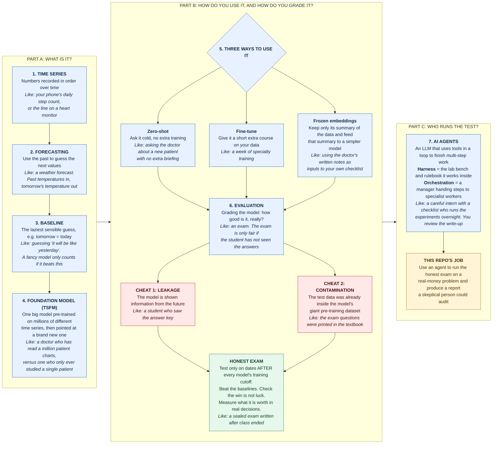

# Tells

**Do pretrained time series models help catch fraud when analysts can only review a fixed number of cases?** Tells answers that with an evaluation built so the model cannot cheat, and an AI agent that runs the experiments and drafts an audit report.

In poker, a "tell" is a small behavior that gives away a hidden hand. A stolen card gives off tells too: odd timing, odd amounts, a sudden change in rhythm. Tells tests whether a time series foundation model (TSFM) can read those tells from an account's history, on top of the checklist-plus-tree-model approach banks use today.

> Status: early build. No results exist yet. Every number in this README that describes data was measured in `docs/data-fit.md`; there are no model results to report.

## The idea in one diagram



More diagrams (the Cleanroom, fraud from zero, the full system) are in [`PLAN.md`](PLAN.md) and [`diagrams/`](diagrams/).

## What is being compared

Four contestants, ranked on the same time-ordered test period and the same daily review budget (for example the top 1% of each day's account-day cases):

| | Contestant | What it is |
|---|---|---|
| A | Lazy baseline | Rank by one simple rule |
| B | Checklist + tree model | Hand-built red-flag features into LightGBM, roughly what banks do today |
| C | TSFM only | Ranking from the pretrained model's view of each account |
| D | Checklist + TSFM embedding + surprise score + tree model | Contestant B with the TSFM's summary of each account added as extra columns |

## Data

Public synthetic data only. No real customer data.

| Dataset | Why it is here |
|---|---|
| [IBM TabFormer](https://github.com/IBM/TabFormer) credit card transactions | 6,139 cards from 1991 to 2020, with a median of 1,493 transactions before a card's first fraud. Long histories to read. |
| [AMLWorld](https://arxiv.org/abs/2306.16424) HI-Small | Money laundering with short histories (median 9 prior events), and the benchmark a published TSFM paper used. |

Why these two, and why IEEE-CIS and PaySim were set aside: [`docs/data-fit.md`](docs/data-fit.md).

## The Cleanroom

The evaluation rules live in `packages/cleanroom`, a separate, domain-neutral package that the sibling projects install from a git tag:

- time-ordered splits with a gap between train and test
- a sealed-envelope lock: the test plan is hashed before any test score exists, and scoring refuses to run without it
- a planted-leak canary that the harness must catch
- bootstrap intervals and multiple-comparison correction, so a lucky win does not look like a real one

## Quickstart

```
uv sync --all-packages
uv run pytest -q
uv run tells --version
```

The data and experiment commands are added as they are built; see `CLAUDE.md` for the current list.

## Repo layout

```
packages/cleanroom/   shared evaluation toolkit (its own package)
src/tells/            data loaders, features, contestants, agent
tests/                tests for tells (cleanroom tests live with the package)
scripts/              data-fit check and download helpers
docs/                 decisions.md, data-fit.md, tsfm-notes.md
data/                 README and checksums only; raw data is gitignored
```

## Limits

- Synthetic data is cleaner than reality. Results here will not show how a model performs on a real bank's data.
- This is not a production fraud system, and the agent never decides who is fraudulent. It runs experiments and drafts reports that a person reviews.
- Results will include the runs where the TSFM did not help.

## More

- [`PLAN.md`](PLAN.md): background from zero, requirements, and the 30-day plan
- [`docs/decisions.md`](docs/decisions.md): every design decision in plain English
- [`CLAUDE.md`](CLAUDE.md): rules for working in this repo
